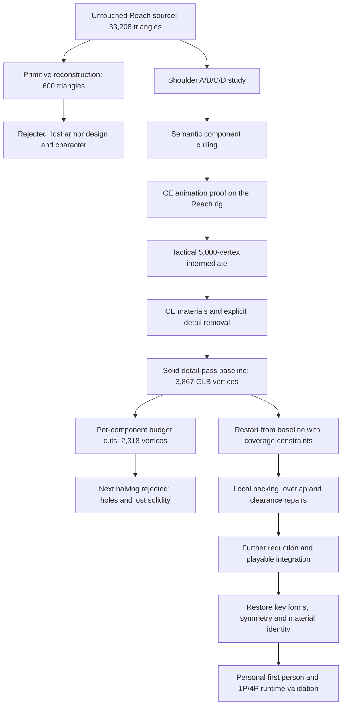

# Reach-to-N64 character demake: Jorge's critical path

Jorge succeeded when we preserved the original armor surfaces, removed details
by component, and made assembled coverage and animation constraints on reduction.
Simple new backing surfaces supplied continuity where the layered Reach model
could no longer survive further collapse. That combination retained the design's
subtle shapes while making substantial reductions possible.

This is the reusable process and its evidence, through code commit `cb7c8591`
and private asset commit `9e7a9f2`. It records the successful intermediate playable
asset, **not completion of the eventual approximately 700-triangle budget**.
The accepted source at that checkpoint was [playable-personal](../../halo64-assets/assets/jorge/playable-personal/):
1,387 GLB vertices, 1,334 native vertices, 2,108 triangles and 2,264 packed N64
vertices, including the backpack. Jorge is the fifth selectable profile, shares
CE motion, has personal first-person arms, and has passed visual
checks in single-player and four-player layouts at 8 MiB. That checkpoint used
the same mesh near and far. The subsequent [near/far reduction](JORGE_LODS.md)
brings packed vertex counts close to CE's, retaining this checkpoint unchanged.

Presentation update, 2026-11-01: first-person legs were subsequently removed to
match CE. The historical experiment and its camera/coverage lessons below remain
part of the trace. The custom arms and complete third-person body are retained.

## The route we actually took

The decisive rollback was to **`detail-pass`, approximately 4,000 vertices**.
`solid-2000` was not a repair applied to the failed lowest-budget mesh. Recovering
the intact source surfaces gave the constrained pass useful geometry to work with.
The later increase from 1,194 to 1,387 exported vertices was also deliberate:
backpack bulk, central forms and close-range coverage earned geometry back.

All counts below are body-only, including the pack. Export vertices include
UV/normal splits; they are not native Blender vertices or packed runtime vertices.

| Checkpoint | GLB vertices | Triangles | Components | Decision / contribution |
|---|---:|---:|---:|---|
| Original assembly | — | 33,208 | 176 physical parts | Preserve as the source of truth |
| `full-cleanup` / `animation-proof` | 20,757 | 26,076 | 110 | Remove inspected fasteners; prove shared motion |
| `tactical-5000` | 4,957 | 4,877 | 110 | Component reduction with transferred skin weights |
| `ce-materials` | 4,403 | 4,802 | 99 | Simplify materials, UV splits and decal overlays |
| `detail-pass` | 3,867 | 4,273 | 64 | Known solid baseline; keep it for later pullbacks |
| `half-budget` | 2,318 | 2,123 | 64 | Useful intermediate; further hard caps failed |
| `solid-2000` | 2,169 | 2,743 | 59 | Restart from `detail-pass`; coverage outranks caps |
| `coverage-repair` | 2,183 | 2,858 | 59 | Repair collar, rump and concealed backing |
| `playable-half` | 1,194 | 1,778 | 49 | Reduce again, repair coverage, integrate in game |
| `playable-refined` | 1,372 | 2,097 | 49 | Restore backpack and central forms; armor gradients |
| `playable-personal` | 1,387 | 2,108 | 51 | Material corrections, thigh caps and personal views |

The separate 600-triangle primitive reconstruction and the subsequent
approximately 1,159-vertex-target destructive experiment are rejected branches.
Neither is an input to the accepted asset. The observed breakdown at roughly a
tenth of source complexity is evidence about this model and method, not a general
percentage limit for character reduction.

## Repeatable sequence and acceptance gates

### 1. Preserve and understand the assembled source

Extract into a separate reference library. Record source hashes, coordinate and
unit conversions, object hierarchy, materials, skeleton, skin weights, component
counts and bounds. Capture front, back, left, right and three-quarter views before
editing. Include attachments using authored markers and parent transforms:
Jorge's field pack was a separate model, not a mesh to position by eye.

Split the inspection into physical components while retaining stable source IDs.
Seventeen material/region objects contained 176 physical parts; material names
alone were too coarse for selective removal. Keep a per-component decision ledger
with geometric class, material, bone influences, original face IDs and cost.

Write down the identity features before assigning budgets. For Jorge these were
the Grenadier helmet and narrow visor, black helmet band, tall collar, yellow
chest, asymmetric shoulders, wide forearms, heavy boots and large field pack.
Distinguish intentional asymmetry from damage introduced by reduction.

**Gate:** the reference is intact, attachments and scale are correct, and every
candidate edit can be traced back. A rest-pose occlusion or a component bounding
box does not establish that a surface is invisible during motion.

### 2. Prove the method on one representative component

The left shoulder supplied a controlled A/B/C/D comparison: original, surgical
cleanup, cleanup plus constrained collapse, and direct collapse at the same count.
Ten small fasteners consumed 1,080 of its 1,924 triangles. Removing only those
left an 844-triangle plate and mount with their original surfaces unchanged.
The two collapsed candidates each had 758 triangles. Sampled maximum surface
error was about 0.779 mm after cleanup versus 1.932 mm for direct collapse.

Most of the gain came from knowing what to remove. The constrained candidate's
visual advantage at small sizes was modest; this was not proof of an automatic
reducer that could solve the whole character. Compare equal counts, matched
front/side/three-quarter views, clay and textured renders, and actual display size.
Surface-distance sampling is useful evidence, not an exhaustive error bound.

**Gate:** the retained plate still reads as the original plate. Scale the
component classification to the body only after this pilot is convincing.
The full cleanup removed 66 fastener components and four degenerate faces:
7,132 triangles saved, with retained positions, UVs, normals and weights preserved.

### 3. Establish animation before aggressive reduction

Retain the source rig and adapt the existing gameplay motion to it. Jorge's
85-bone Reach hierarchy received 19 shared CE motion channels after bind-axis
calibration. Extra spine/fixup motion and fingers needed explicit approximations.
Compose overlays correctly; copying raw channels without their base pose is not
equivalent to copying the animation.

Prove idle, run, fire and reload first. Validate independent skinning, exported
animation and weapon contact. Jorge needed a length-preserving support-arm solve,
a support hand that follows the original reload trajectory, his own `b_r_grip`
socket, and root-height correction for his larger boots. Pinning the hand to the
rifle throughout reload or stretching legs to reach the ground would hide errors.

**Gate:** the editable rig and reimported GLB agree through motion; attachments
follow the intended sockets; joints and underlapping surfaces stay useful.
The first proof covered 174 source poses / 178 playback samples in four clips.
Its flat-ground adjustment was not terrain IK, and the rig approximations did not
recreate Reach's procedural jiggle controllers. Extend coverage as gameplay states
are added; the final bank has 39 clips and 1,530 frames.

### 4. Reduce structure and appearance independently

| Geometric class | Treatment that proved useful |
|---|---|
| Helmet and visor | Protect identity and curvature first; later require a measured share of the budget |
| Main armor plates | Retain authored surfaces, taper and panel breaks; simplify redundant interior construction |
| Undersuit | Reduce wrinkles and dense curvature while preserving continuous backing and joint motion |
| Mechanical details | Explicitly cull expendable fasteners, straps, decals and covered fittings |
| Hands and joints | Preserve articulation, normalized weights and contact behavior; inspect moving poses |

For the 5,000-vertex intermediate, weld only compatible skin weights, dissolve
conservative planar redundancy, and collapse components separately with reviewed
minimums. Transfer weights from the nearest source triangle using barycentric
coordinates and normalize them; Jorge uses at most four influences. Preserve
source correspondence honestly: changed topology gets nearest-face/barycentric
records, not stale IDs claiming it is an unchanged original vertex.

UV seams, normal discontinuities, hard edges and deformation regions are candidate
constraints, not an unconditional lock on every source split. The shoulder study
verified protected positions and edges after the operation rather than trusting
a modifier's weighting alone. **Automatic semantic bevel-loop recognition was
not implemented**; the pipeline used conservative cleanup and weighted collapse.

Then simplify the material system against the target renderer. CE donor regions
became sixteen 64×64 tiles in a 256×256 atlas, fitted by surface orientation.
Fifteen materials and 27 embedded images became two materials and one image;
normal maps and unsupported alpha decal overlays were removed. This lowered
export vertex cost without an equivalent loss of geometric surface detail.
The following explicit detail pass removed 35 more components, leaving 64.

Preserve broad color identity early. The black band and gray-brown pack mattered
more than tiny fasteners. Later broad metallic gradients aligned armor with the
standard Spartans; the final pack instead uses a matte, low-resolution treatment
sampled from the original Reach gear. The warm shoulder/hand plates remain
distinct from olive armor. Material roles need separate treatment.

**Gate:** inspect both shape and target shading. Early normal-map bakes helped
the shoulder experiment, but the final N64 body uses baked vertex colors, not
runtime normal mapping. A successful textured Blender render alone is insufficient.

### 5. Make coverage constraints stronger than component budgets

Separate budgets helped distribute cost, but did not keep the assembled model
solid. Repeated collapse opened shells and shrank neighboring surfaces apart.
Overall silhouette overlap, bounds and proximity to the source could all look
reasonable while armor-to-fabric seams became holes.

Restart from the last solid checkpoint when that happens. For `solid-2000`, the
reducer protected actual open rims, authored nonmanifold joins, extrema, and rim
skin weights. It checked boundary sets, topology, closed-component volume and
sampled surface error. Budgets became soft targets: failing knees, boots and
upper arms retained more topology. Normal clustering reduced redundant export
splits while preserving larger shading breaks.

Jorge's implementation used 90–110% volume retention for closed components,
regional maximum error limits and a 20 mm sampled p95 limit. These are recorded
settings for this scale, not universal acceptance thresholds. Preserve the
source's topology classes; demanding that every originally open armor part be
watertight is different from preventing new holes in the assembled character.

**Gate:** check native and quantized geometry across views and poses. Use body
and armor-part masks, new enclosed background pixels, and changes to open gaps
between limbs. A body-union mask can conceal lost armor behind visible undersuit.
Part-ID renders help locate responsible components. Compare to both the intact
design reference and the last accepted stage; small errors can otherwise accumulate.

### 6. Construct continuity locally, then reduce again

This was the useful middle ground: original visible armor plus simple fitted
backing, return faces and overlap. Avoid replacing a nuanced plate with a box.
Spend a few triangles where they preserve the whole character's solidity.

The green support poking through the yellow collar was recessed 28 mm; both
follow the same torso bone. Yellow and red armor remained unchanged. Fitted
undersuit backing closed thigh, torso and shoulder openings, and a small rump
return followed the neighboring rim with compatible weights. This repair cost
14 exported vertices / 115 triangles; 53 of 59 components stayed unchanged.
The dangling black pack connector remained removed. Codpiece clearance was
handled by fitting the plate, not by cutting a hole in the underlying fabric.

The next reduction was an ordered pipeline, encoded in
[finalize_jorge_playable.py](finalize_jorge_playable.py):

1. Reduce components from the repaired source and remove selected covered fittings.
2. Seal suitable armor loops without moving the exterior perimeter.
3. Restore garment coverage and fit small overlaps.
4. Add local seam backing from original source triangles.
5. Run the coverage gate before baking animation and exporting.

Jorge-specific choices included restored thigh/shoulder garment components,
overlap capped at 16 mm, fixed collar/rump repairs and 18 source seam triangles.
These component IDs and offsets must be rederived for another character.
The output accepted 1,194 exported vertices instead of enforcing the 1,092 target.

**Gate:** no new enclosed holes at intended game scale, no new invalid geometry,
and no regressed motion or clearance. The playable/refined checks covered 140
quantized view/pose images: seven pose samples, ten directions and two game-scale
sizes (64 and 96 pixels). They found zero new enclosed holes; enlarged diagnostic
renders still showed up to nine isolated seam pixels. This is scoped evidence,
not proof of watertightness or exhaustive coverage of every animation frame.

### 7. Compare with the actual game assets and integrate early enough to learn

Use the same pose, scale, camera and packed color rendering for the standard
Spartan and the candidate. At the playable comparison checkpoint the standard
Spartan had 328 near / 135 far triangles and 562 / 250 packed vertices. Jorge
remains substantially heavier. The world AR used in later comparisons is the
actual 140-triangle port asset; the early animation proof's 764-triangle CE AR
must not be mistaken for the production weapon or included in the body budget.

Bake **Jorge's own** animated vertices and grip sockets from the adapted rig.
CE vertex trajectories and socket matrices cannot simply be reused on different
geometry. Packing may merge vertices only when their full relevant animated
trajectories agree, not merely their bind positions. Preserve animation bounds.

The runtime streams a separate bank, retaining the mesh and two requested frame
endpoints in RAM. Five selectable profiles remain separate from four controller
slots. Buffer lifetime, per-player state, selection screens, HUD/results names,
and an 8 MiB guard are part of integration. The current body bank occupies
20,881,840 ROM bytes; its reported mesh and endpoint cache are 49,360 and 27,232
bytes. Those figures are not the total match-memory requirement.

Track four separate costs: native vertices, exported vertices, triangles and
packed N64 vertices. UV/normal splits and Tiny3D batch/color copies explain why
they differ. Also measure batches, transformed vertices, animation storage and
live per-player buffers. A lower GLB count does not automatically lower all costs.
Jorge uses 512 position units per Halo unit, about a 6 mm grid; the standard
Spartan's 128-unit grid reopened seams. Validate the packed result, not just floats.

**Gate:** all states, sockets and bounds survive serialization, then rendering
and interactions work in game. Body bank validation covers 39 clips / 1,530 frames;
GLB reimport checks five samples per clip. These are separate from the 140-image
coverage test, and export agreement does not measure fidelity to the original mesh.

### 8. Refine identity and validate the player's actual views

Restore important forms when the comparison exposes a loss. The refinement
retrieved the backpack's broad upper shape from the preserved detail-pass source,
repaired central symmetry, and retained intentional shoulder asymmetry. It was
correct to spend geometry here before attempting another final reduction.

First person needs its own proof. Four original Jorge forearm components add
74 packed vertices / 88 triangles over continuous CE glove/sleeve backing.
Binding to the existing animated forearms reuses weapon clocks and service actions
without a new animation bank. Looking down draws a 783-triangle subset of the
animated body; two small cloth caps close newly exposed thigh openings.

Distinguish geometry faults from renderer faults. The world near plane cut through
the thighs during look-down/crouch; putting local legs in the foreground projection
with the arms fixed that, while retaining shared depth. A separate passenger bug
came from animation and drawing disagreeing about whether a seated player could
use a first-person weapon. A shared availability predicate fixed the stale mesh.

**Gate:** inspect real weapons, service actions, vehicle seats and entry/exit,
then single-player and four-player first-person layouts. Include mixed standard
and custom profiles, differing actions and profile transitions to expose shared
buffer/color errors. Four-Jorge QA deliberately stresses buffers beyond the normal
unique-profile selection rule. Keep the fixture alive: firing rockets into the
ground invalidated early look-down samples, so those pages use non-explosive weapons.

The actual first-person C binding passed sanitizers on 1,409 production poses.
Final visual captures cover all nine weapon choices (including the existing
flamethrower-to-AR alias), actions and standing/walking/crouching legs at 8 MiB.
Ares's **4MB Expansion Pak option is enabled**, giving 8 MiB total, and is to remain
enabled for Halo. Earlier notes about permission pending or 4 MiB captures are
historical. These checks are not physical-console performance qualification or
full-match memory profiling; see [current acceptance](JORGE_FIRSTPERSON.md).

## What to carry forward for the next character

At each accepted checkpoint, save an independent BLEND and body-only GLB, source
and parent-stage hashes, per-component budgets/decisions, material inputs, skin
correspondence, animation data, validation reports and matched comparison renders.
Keep rejected candidates clearly labeled and preserve the last solid source.
Store packed previews and capture hashes once the asset is integrated. A useful
handoff states exactly which views, poses and runtime configuration passed and
which limitations remain.

Run the sequence above with gates between stages. If a hard budget breaks coverage,
reject the candidate, restore the nearest sound source, and change the constraints
or add fitted continuity before retrying. Do not continue halving a damaged mesh.
Do not treat the first conservative helmet mask as a permanent exemption from cost.
Judge recognizability and material roles at game size throughout.

The scripts below are implementations and examples, **not a character-independent
one-command converter**. Source IDs, rig mappings, feature priorities, symmetry,
overlap tolerances and material regions encode Jorge-specific decisions.

| Stage | Maintained implementation | Evidence / detailed procedure |
|---|---|---|
| Extraction and inspection | [reach_cache.py](reach_cache.py), [extract_jorge.py](extract_jorge.py), [jorge_workshop.py](jorge_workshop.py) | [Original inspection](../../halo64-assets/assets/jorge/source-inspection.json); [historical initial attempt](JORGE.md) |
| Shoulder pilot | [jorge_shoulder_study.py](jorge_shoulder_study.py) | [A/B/C/D study](JORGE_SHOULDER_STUDY.md) |
| Full semantic cleanup | [jorge_surgical_source.py](jorge_surgical_source.py), [jorge_surgical_cleanup.py](jorge_surgical_cleanup.py) | [Cleanup and intermediate history](JORGE_SURGICAL_CLEANUP.md) |
| Shared animation | [jorge_animation_preflight.py](jorge_animation_preflight.py), [jorge_animation_proof.py](jorge_animation_proof.py), [validate_jorge_animation.py](validate_jorge_animation.py) | [Animation proof](../../halo64-assets/assets/jorge/animation-proof/) |
| Tactical geometry, CE palette, detail culling | [jorge_tactical_reduce.py](jorge_tactical_reduce.py), [jorge_ce_materials.py](jorge_ce_materials.py), [jorge_detail_pass.py](jorge_detail_pass.py) | [Preserved detail-pass baseline](../../halo64-assets/assets/jorge/detail-pass/) |
| Constrained restart and local repairs | [jorge_solid_reduce.py](jorge_solid_reduce.py), [jorge_coverage_repair.py](jorge_coverage_repair.py) | [Solid reduction](../../halo64-assets/assets/jorge/solid-2000/); [repair report](../../halo64-assets/assets/jorge/coverage-repair/repair-report.json) |
| Playable reduction and coverage gate | [finalize_jorge_playable.py](finalize_jorge_playable.py), [validate_jorge_playable.py](validate_jorge_playable.py) | [Playable checkpoint](JORGE_PLAYABLE.md) |
| Bake, pack and runtime | [bake_jorge_playable.py](bake_jorge_playable.py), [pack_jorge.py](pack_jorge.py), [jorge_render.c](jorge_render.c), [test_jorge_bank.py](test_jorge_bank.py) | [Current runtime report](../../halo64-assets/assets/jorge/playable-personal/runtime-report.json) |
| Form/material refinement | [refine_jorge.py](refine_jorge.py), [personalize_jorge.py](personalize_jorge.py) | [Refinement](JORGE_REFINEMENT.md); [current appearance and first person](JORGE_FIRSTPERSON.md) |
| First-person binding and field checks | [pack_jorge_firstperson.py](pack_jorge_firstperson.py), [test_jorge_firstperson.py](test_jorge_firstperson.py), [jorge_field_qa.h](jorge_field_qa.h) | [Capture provenance](../../halo64-assets/assets/jorge/playable-personal/firstperson-capture-report.json); [layout comparison](../../halo64-assets/assets/jorge/playable-personal/firstperson-layout-comparison.png) |

To reproduce the current accepted bank, follow [JORGE_FIRSTPERSON.md](JORGE_FIRSTPERSON.md).
Pass `--asset-dir halo64-assets/assets/jorge/playable-personal --name jorge-playable-personal`
to `pack_jorge.py`; its historical default selects the older playable-half stage.
Background authoring scripts should write separate libraries, not save over a live
Blender project. Private source/assets are in the `halo64-assets` submodule;
generated ROMs do not replace the owned source caches.

## Checkpoint history and remaining work

| Main repository | Asset submodule | Checkpoint |
|---|---|---|
| `ecef9109` | `2301790` | Initial authoring history through the CE detail-pass baseline |
| `f99a96a5` | `51c7ec2` | Half-budget intermediate and production AR comparison |
| `5ed7bade` | `fc4ec6e` | Restart with coverage constraints |
| `acd2607d` | `43d0942` | Collar/rump/backing repairs |
| `08e91624` | `0e6ca6a` | Reduced fifth playable profile |
| `a2d38c91` | `f5a2364` | Form, gradients and vehicle/camera refinement |
| `7daf459d` | `a6a67e2` | Personal materials, first-person arms and legs |
| `cb7c8591` | `9e7a9f2` | Single/four-player visual acceptance at 8 MiB |

Future optimization should begin from the accepted personal asset, retaining the
earlier solid sources for local restoration. The remaining work is the final
approximately 700-triangle target, a dedicated distant LOD, and measured runtime
cost under representative matches. Keep triangle and vertex targets explicit:
the original request was 600 triangles, later approximately 700; the intermediate
5,000 / 2,000 / halving requests were vertex milestones. This history establishes
a reliable starting point and review process, not a guarantee that another blind
halving can meet the final budget.
